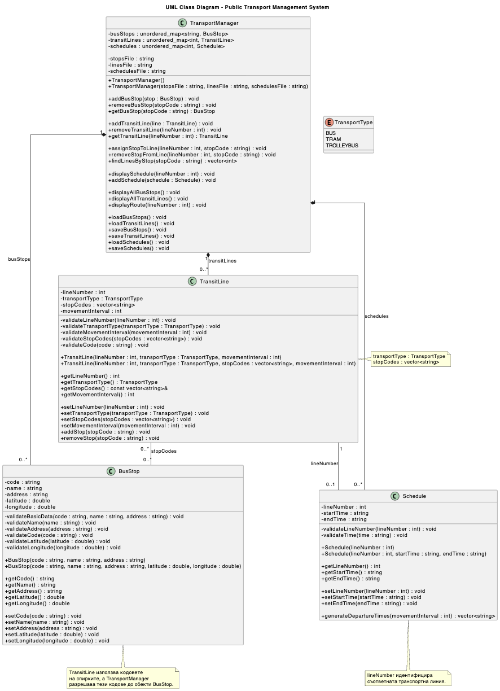

# Urban Transport System

A C++ console application for managing urban public transport. The system stores information about bus stops, transit lines, and schedules, maintains the relationships between them, and generates departure times based on the configured movement interval.

The project was developed as a coursework assignment for the **Programming Languages** course at the Technical University of Sofia.

## What the application can do

- Add and remove bus stops with a unique code, name, address, and geographic coordinates.
- Create bus, tram, and trolleybus lines.
- Add stops to a route and check whether they exist.
- Find which lines pass through a selected bus stop.
- Display a line's route using the names and codes of its stops.
- Create a schedule with a start time and an end time.
- Generate departure times based on the movement interval of the corresponding line.
- Load and save data in CSV files so that it is preserved between application runs.

## Technologies used

- **Language:** C++11 or later.
- **Standard library:** `string`, `vector`, `unordered_map`, `unordered_set`, `fstream`, `sstream`, and other standard components.
- **Data storage:** CSV files.
- **Compiler:** GCC or Clang.

No external libraries are required.

## Project structure

```text
UrbanTransportSystem/
├── include/
│   ├── BusStop.h
│   ├── Schedule.h
│   ├── TransitLine.h
│   ├── TransportManager.h
│   └── TransportType.h
├── src/
│   ├── BusStop.cpp
│   ├── Schedule.cpp
│   ├── TransitLine.cpp
│   ├── TransportManager.cpp
│   ├── TransportType.cpp
│   └── main.cpp
├── data/
│   ├── bus_stops.csv
│   ├── transit_lines.csv
│   └── schedules.csv
├── diagram.puml
├── UrbanTransportSystemDiagram.png
└── README.md
```

`include/` contains the declarations of the classes and types, while `src/` contains their implementations and the main program. The files in `data/` store the saved application data. The UML diagram is available as a PNG image, and `diagram.puml` contains its PlantUML source.

## Main classes

### `BusStop`

Represents an urban public transport stop. It stores:

- a unique code;
- a name;
- an address;
- latitude and longitude.

The class provides constructors with and without coordinates. Data is validated both when an object is created and when its values are changed. The code may contain only Latin letters and digits. The name and address may contain Cyrillic and Latin letters, digits, and permitted punctuation. Coordinates are checked against the geographic ranges: latitude from `-90` to `90` and longitude from `-180` to `180`.

### `TransitLine`

Describes a transit line through:

- a positive line number;
- a transport type (`BUS`, `TRAM`, or `TROLLEYBUS`);
- a movement interval in minutes;
- a route represented by a `vector<string>` containing the stop codes in the correct order.

The class checks whether the stop codes are valid and whether any code is repeated in the route. The existence of the stops themselves is checked by `TransportManager`, which has access to the registry of all stops.

### `Schedule`

Stores the schedule of a line – its start and end times in `HH:MM` format (24-hour format). By default, the constructor sets the operating period from `06:00` to `23:00`.

The `generateDepartureTimes()` method calculates departure times using the supplied interval in minutes. The start time is included, and generation continues as long as the next departure does not exceed the end time. For example, for the period `06:00–07:00` and an interval of 20 minutes, the result is `06:00`, `06:20`, `06:40`, `07:00`. The start time cannot be later than the end time, so schedules that cross midnight are not supported.

### `TransportManager`

The central class responsible for managing the data and relationships between objects. It uses three `unordered_map` collections:

- `busStops` – bus stops indexed by code;
- `transitLines` – transit lines indexed by line number;
- `schedules` – schedules indexed by line number.

The class checks whether the stops in a route are registered and whether a schedule is being added only for an existing line. Each line can have at most one schedule. When a bus stop is removed, its code is also removed from all routes. When a line is removed, its associated schedule is removed as well.

`TransportManager` is also responsible for loading and saving the CSV files. Data is loaded in sequence – first the bus stops, then the transit lines, and finally the schedules – because each subsequent group depends on the objects loaded before it.

### `TransportType`

An enumeration (`enum class`) that defines the supported transport types: `BUS`, `TRAM`, and `TROLLEYBUS`. The helper functions `parseTransportType()` and `transportTypeToString()` convert the text representation to an enum value and back.

## UML diagram

The diagram shows the classes, their main attributes and methods, and the relationships between `TransportManager`, `BusStop`, `TransitLine`, and `Schedule`.



The PlantUML source is available in [`diagram.puml`](diagram.puml).

## Building and running

A C++ compiler supporting C++11 or later is required.

Open a terminal in the project's root directory – the directory containing the `include/`, `src/`, and `data/` folders.

## Running on Windows

### Prerequisites

- Windows 10 or Windows 11
- GCC compiler (MinGW-w64)
- MinGW-w64 added to the system `PATH` environment variable

To verify that GCC is installed, open PowerShell or the VS Code terminal and run:

```powershell
g++ --version
```

### 1. Compile the project

Navigate to the root directory of the project and execute:

```powershell
g++ -std=c++11 -Wall -Wextra -pedantic -Iinclude src\BusStop.cpp src\Schedule.cpp src\TransitLine.cpp src\TransportManager.cpp src\TransportType.cpp src\main.cpp -o UrbanTransportSystem.exe
```

### 2. Run the application

After successful compilation, start the application using:

```powershell
.\UrbanTransportSystem.exe
```

**Note:** Run the application from the project's root directory. The `data` folder must be present because the application uses the following CSV files to store and load its data:

- `data/bus_stops.csv`
- `data/transit_lines.csv`
- `data/schedules.csv`

The executable file `UrbanTransportSystem.exe` will be generated in the root directory after compilation.

### Linux

```bash
g++ -std=c++11 -Wall -Wextra -pedantic -Iinclude src/*.cpp -o UrbanTransportSystem
./UrbanTransportSystem
```

### macOS

```bash
clang++ -std=c++11 -Wall -Wextra -pedantic -Iinclude src/*.cpp -o UrbanTransportSystem
./UrbanTransportSystem
```

The application uses relative paths to `data/bus_stops.csv`, `data/transit_lines.csv`, and `data/schedules.csv`. Therefore, run it from the project's root directory. The `data/` folder must already exist; the application can create missing CSV files inside it, but it does not create the folder itself.

## Using the application

At startup, one of two modes is selected:

1. **Use existing CSV files** – previously saved data is loaded. If any of the files is missing, it is created with the corresponding header row.
2. **Create a new data set** – all three CSV files are cleared and recreated with only their header rows.

> **Warning:** The second mode deletes the saved bus stops, transit lines, and schedules. Select it only when you actually want to start with an empty data set.

After loading, the menu is displayed:

| Option | Action |
|---:|---|
| `1` | Add a bus stop |
| `2` | Add a transit line |
| `3` | Add an existing bus stop to a route |
| `4` | Find lines by bus stop code |
| `5` | Display a line's route |
| `6` | Add a schedule to a line |
| `7` | Display a schedule and its generated departure times |
| `8` | Display all bus stops |
| `9` | Display all transit lines |
| `10` | Remove a bus stop |
| `11` | Remove a line and its schedule |
| `0` | Save the data and exit |

When adding a line, its number, transport type, and movement interval are entered first. Stops are added to the route separately using option `3`.

The transport type can be selected using `1`, `2`, or `3`, or by entering a recognized text name. A period (`.`) must be used as the decimal separator when entering fractional coordinates.

Changes are saved to the CSV files after every operation that modifies the data and when option `0` is selected to exit.

## CSV file formats

The files contain a header row followed by one record per line. The sample records below are provided only to illustrate the format.

### `data/bus_stops.csv`

```csv
code,name,address,latitude,longitude
S001,Example Stop,Example Street 1,0.0,0.0
```

### `data/transit_lines.csv`

```csv
lineNumber,transportType,movementInterval,stopCodes
1,Автобус,20,S001;S002;S003
```

The stop codes in a route are stored in a single field, separated by semicolons (`;`). When saved, the transport type is stored using its Bulgarian name.

### `data/schedules.csv`

```csv
lineNumber,startTime,endTime
1,06:00,23:00
```

The CSV handling supports enclosing fields in quotation marks when they contain commas or quotation marks, as well as doubling quotation marks inside a field. New lines inside an individual field are not supported.

## Validation and error handling

The classes validate data when objects are created and when setters are called. Invalid values cause an `invalid_argument` exception with a description of the problem. Errors when opening or writing files are reported through `runtime_error` exceptions.

The main program handles exceptions both at startup and during the execution of individual commands. This allows an error in one operation to be shown to the user without necessarily terminating the entire application.

## Project scope

The application is a console-based system for managing transit line data. Geographic coordinates are stored as part of the bus stop information, but the project does not display stops on a map. The schedule generates departure times at a fixed interval; it does not calculate journey duration or travel times between individual stops.
